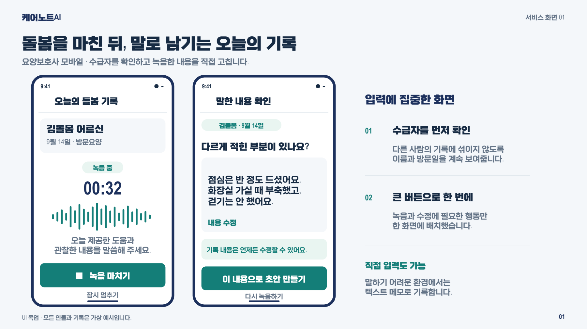
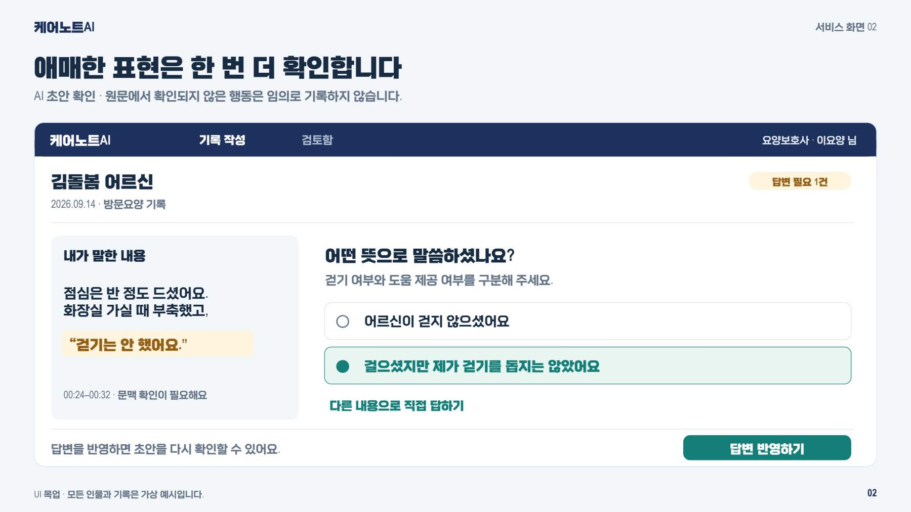
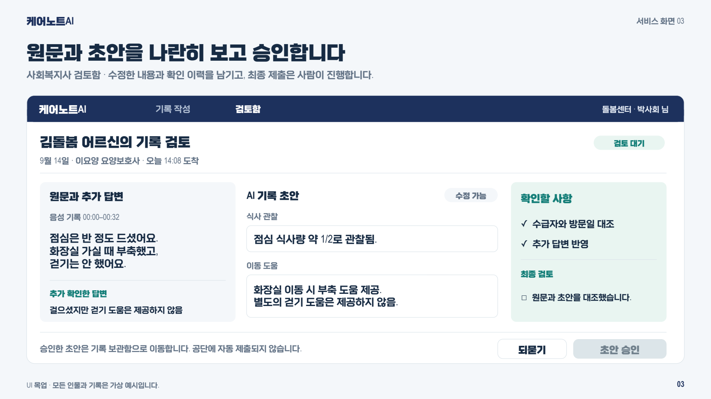

# 케어노트AI

> 요양보호사의 현장 음성을 **사실 단위로 확인**한 뒤, 사회복지사가 검토할 수 있는
> **방문요양 기록지 초안**으로 변환하는 양식 자동화 서비스.

관통 원칙: **말하지 않은 것은 기록하지 않는다.** AI는 초안까지, 확인·승인·제출은 사람(HITL).

**목표:** 2026 지능정보 SW 아이디어 경진대회 (제출 2026-10-15 · 발표 2026-10-16, 15분).
제출물은 발표자료 PDF 1벌이며, 실행 가능성 근거로 PoC 코드를 함께 만든다.

## 🖥️ 화면 (UI 목업)

| 요양보호사: 녹음하고 내용 확인 | 애매한 표현은 다시 물어보기 | 사회복지사: 원문과 초안 비교 후 승인 |
| --- | --- | --- |
|  |  |  |

<br>

## 📌 문제 정의

소형 방문요양센터의 사회복지사는 요양보호사가 남긴 짧은 메모나 음성을 다시 해석해서, 방문요양 기록지의 정해진 항목과 표현에 맞춰 반복해서 옮겨 적습니다.

```text
요양보호사 현장 메모   "점심 거의 안 드시고 걸을 때 어지럽다고 하심"
        ↓  사회복지사가 다시 해석·정리
방문요양 기록지 초안
```

문제는 시간만이 아닙니다. 노인 질환은 식욕부진이나 어지럼처럼 조용하게 오는 경우가 많아서, 이런 작은 변화가 기록에서 빠지면 위험 신호를 놓칠 수 있습니다. 그렇다고 AI가 그럴듯하게 문장을 지어내면 **말하지 않은 사실이 공식 기록에 들어가는** 더 큰 문제가 생깁니다.

그래서 케어노트AI는 음성을 바로 문서로 만들지 않고, **사실과 불확실한 부분을 먼저 분리한 뒤 사람이 확인**하게 하는 데 집중합니다. 자세한 근거와 통계는 [경진대회 기획서 §1](./docs/경진대회2026/케어노트AI_경진대회_기획서_v2.md)에 있습니다.

<br>

## 🎯 이 프로젝트에서 한 일

- **문제 재정의:** "행정 전반 AI 에이전트"에서 "현장 음성 → 방문요양 기록지 초안"이라는 단일 업무로 범위를 줄였습니다 (2026-09-18 피벗).
- **기술 선정:** ASR 후보(Whisper-small + LoRA, large-v3, Qwen3-ASR)와 사실 추출 방식을 비교하고, LLM은 구조화 출력과 표현 다듬기에만 쓰기로 정했습니다. → [기술선정·연구검토](./docs/경진대회2026/케어노트AI_기술선정_연구검토_v1.md)
- **시스템 설계:** 처리 흐름, 작업 상태, 데이터 모델, 안전 원칙을 하나의 설계서로 정리했습니다. → [통합 기술설계서](./docs/경진대회2026/케어노트AI_통합기술설계서_v1.md)
- **화면·발표:** UI 목업 3장과 15분 발표 자료를 만들었습니다.

> 현재 코드는 뼈대 단계입니다. 아래 [코드 상태](#코드-상태)를 참고하세요.

---

## 단일 기준 문서 (SSOT)

> 2026-09-18 피벗: "행정 전반 AI 에이전트" → **"현장 음성 → 방문요양 기록지 초안" 단일 업무**로 재설계.

- 서비스 기획(문제·차별성·기대효과·발표구성): [`경진대회 기획서 v2`](./docs/경진대회2026/케어노트AI_경진대회_기획서_v2.md)
- 통합 기술설계(시스템 구성·데이터모델·평가): [`통합 기술설계서 v1`](./docs/경진대회2026/케어노트AI_통합기술설계서_v1.md)
- 모델·시스템 후보 비교: [`기술선정·연구검토 v1`](./docs/경진대회2026/케어노트AI_기술선정_연구검토_v1.md)
- 음성인식 학습 연구안: [`고령 실무자 음성인식 학습 연구안 v1`](./docs/경진대회2026/케어노트AI_고령실무자_음성인식_학습연구안_v1.md)
- 한눈에 보기: [`프로젝트 지도`](./docs/개요/프로젝트지도.html) · [`한 장 요약`](./docs/개요/한장요약.html) · 발표용 [`도식 PPTX`](./docs/발표/케어노트AI_개요도_도식_v1.pptx)
- 발표 시안(피벗 전 v2, 재작성 베이스): [`docs/발표/`](./docs/발표/) · UI 목업: [`docs/UI목업/`](./docs/UI목업/)

---

## 처리 흐름 (통합기술설계서 §4)

```
[모바일 웹] 수급자 선택 · 짧게 녹음 · 업로드
     ↓
[전처리] 포맷 변환 · 구간 분리 · VAD (무음/잡음 감지)
     ↓
[음성인식] 자체 서버 ASR — 원문 전사 · 구간 시각 · 신뢰도 점수
     ↓
[위험 판정] 허위 전사 · 저신뢰 구간 · 중요표현 점검 → '확인 필요' 표시
     ↓
[사실 추출] PII 최소화 후 구조화 — 관찰사실 · 부정 · 시점 · 수행여부 · 근거
     ↓
[양식 작성] 필드 검증 + 템플릿 → 기록지 초안 · 누락항목 · 확인질문
     ↓
[검토·승인] 사회복지사가 음성·원문·초안을 나란히 확인 → 수정 → 승인
     ↓
(선택) 시연용 데모 양식 자동채움 — 무인 자동 제출은 제외
```

작업 상태: `uploaded → transcribing → extracting → needs_review → approved`
(정보 부족 `needs_info`, 실패 `failed`로 분리)

## 데이터 모델 (통합기술설계서 §8)

| 개체 | 핵심 정보 |
|---|---|
| Recording | 녹음 ID · 접근권한 · 저장위치 · 동의/보관 |
| TranscriptSegment | 시작·종료 시각 · 원문 · 모델 버전 · 원시 점수 |
| Fact | 값 · 대상 · 부정 · 시점 · 수행여부 · 근거 · 검토상태 |
| Draft | 양식 버전 · 사실 목록 · 초안 버전 · 승인 상태 |
| ReviewIssue | 문제 구간 · 확인 사유 · 사용자 수정/처리 결과 |
| ExperimentRun | 모델·데이터 버전 · 설정 · 시드 · 평가 결과 |

## 기술 스택 (통합기술설계서 §5)

| 영역 | 우선 검토안 |
|---|---|
| Frontend | Next.js 반응형 웹 (MediaRecorder 녹음) |
| Backend | FastAPI (녹음 접수 + 작업 상태 조회, 음성인식은 별도 워커) |
| ASR | Whisper-small + PEFT LoRA (기본성능 비교: large-v3 / Qwen3-ASR), 배포는 faster-whisper |
| 사실 추출 | 구조화 출력 LLM (외부 API는 마스킹 후 / 로컬 Qwen3 후보) |
| 양식 작성 | 코드 기반 필드 매핑·검증 (표현 다듬기에만 제한적 LLM) |
| DB / 검색 | PostgreSQL (+필요 시 pgvector) |
| 워크플로 | 고정 절차 + 명시적 규칙 우선. LangGraph는 분기·중단·재개가 필요할 때만 |

> **의도적 비목표:** LangGraph·파인튜닝·자율 브라우저 조작을 목표로 삼지 않는다.
> 문서 생성 LLM 파인튜닝은 보류, 음성인식 경량 학습(LoRA)만 핵심 연구 후보.

---

## 코드 상태

**뼈대만 존재 (거의 코드 0줄).** 옛 넓은 스코프의 뼈대(`apps/extension` 자동채움, `agents/` ReAct 그래프, `rag/`)는
2026-10-12에 삭제했다(git 기록에 남아 있음). 남은 뼈대를 위 처리흐름·데이터모델에 맞춰 채워 나간다.

```
apps/web/          # Next.js — 녹음 + 검토·승인 화면
services/api/       # FastAPI — 녹음 접수 · 작업상태 · STT 워커 · 사실추출 · 양식작성 · 규칙검증
packages/shared/    # 공통 스키마
infra/              # docker-compose · migrations
```

## 안전 원칙 (통합기술설계서 §3.2·§5.5)

- 음성에 없는 관찰·수행 사실을 추가하지 않는다 (환각 금지).
- 애매한 구간은 확정하지 않고 **원문과 함께 확인 요청**한다.
- 원문 전사 · 추출 사실 · 양식 문장을 **별도 보관**하고, 승인 전/후 기록을 구분한다.
- 음성은 **자체 운영 서버**에서 처리 우선(온디바이스와 다름). 외부 LLM 전송 시 PII 최소화·가명화.
- 수정·승인 이력을 감사로그로 남기되, 원문 개인정보를 불필요하게 중복 저장하지 않는다.
- 자동채움은 **데모/허용된 자체 양식**에서만 검증. 무인 자동 제출 없음.
